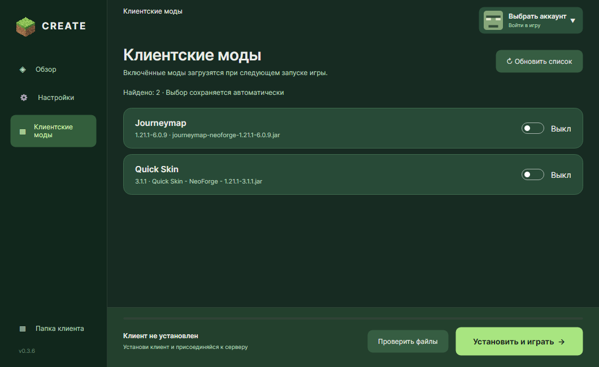

# Create Launcher


Портативный лаунчер для **Minecraft 1.21.1 · NeoForge 21.1.264**.

[](https://github.com/pressftorun/minecraftlauncher/actions/workflows/build.yml)
[](https://github.com/pressftorun/minecraftlauncher/releases/latest)
[](LICENSE)

[Скачать](#скачать) · [Первый запуск](#первый-запуск) · [Разработка](CONTRIBUTING.md) · [Сообщить об ошибке](https://github.com/pressftorun/minecraftlauncher/issues/new/choose) · [Безопасность](SECURITY.md)

Устанавливает клиентскую сборку, Java и NeoForge в одну папку. Русский и английский интерфейс, сохранённые профили, выбор памяти и Java, проверка файлов и состояние сервера. В версии **0.3.6** список клиентских модов обновляется отдельным архивом около **9 МБ** с отображением прогресса.



| Репозиторий | Содержимое |
| --- | --- |
| **minecraftlauncher** — этот проект | Интерфейс, установка, авторизация и запуск игры |
| [minecraftversion](https://github.com/pressftorun/minecraftversion) | Моды, конфиги, ресурсы меню и архив клиента |

## Скачать

| Система | Лаунчер 0.3.6 |
| --- | --- |
| Windows x64 | [Скачать ZIP](https://github.com/pressftorun/minecraftlauncher/releases/download/v0.3.6/CreateLauncher-0.3.6-win-x64.zip) |
| Linux x64 | [Скачать ZIP](https://github.com/pressftorun/minecraftlauncher/releases/download/v0.3.6/CreateLauncher-0.3.6-linux-x64.zip) |

[Все релизы](https://github.com/pressftorun/minecraftlauncher/releases) · [Изменения](CHANGELOG.md) · [Клиентская сборка](https://github.com/pressftorun/minecraftversion)

.NET и Python устанавливать не нужно. Клиент, Java 21 и NeoForge скачиваются автоматически. Контрольные суммы архивов находятся в `SHA256SUMS.txt` рядом с файлами релиза.

## Первый запуск

1. Распакуйте **весь архив** в доступную для записи папку. Соседние DLL/SO и папку `Assets` оставьте рядом с программой.
2. Windows: запустите `CreateLauncher.exe`. Linux: выполните `chmod +x CreateLauncher`, затем `./CreateLauncher`.
3. Выберите профиль по нику, Ely.by или TLauncher.org и нажмите **«Установить и играть»**.

Нужен интернет. На Linux требуется графическая сессия и библиотеки X11/fontconfig/OpenGL. Файлы игры и настройки сохраняются в `data/` рядом с лаунчером. Сервер `46.146.228.125:25565` добавляется в мультиплеер с сохранением существующего списка.

Карточка сервера показывает доступность и число игроков, обновляется раз в 30 секунд и по кнопке. Кнопка BlueMap открывает [карту мира](http://46.146.228.125:8100/).

## Обновление и восстановление

Лаунчер проверяет новые стабильные версии при запуске. Если обновление доступно, нажмите **«Обновить»** в уведомлении или **«Обновить и перезапустить»** в настройках. Архив Windows/Linux x64 скачивается из официального релиза GitHub и проверяется по SHA-256. После закрытия окна отдельный процесс заменяет файлы и запускает новую версию. При ошибке копирования предыдущие файлы восстанавливаются; журнал ошибки — `launcher-update-error.log`. Папка `data/`, `launcher.json` и локальный `client.zip` сохраняются. Файлы предыдущей версии остаются в `data/launcher-updates/`.

В версиях без встроенного обновления нужно один раз распаковать новую версию поверх старой. Кнопка **«Проверить файлы»** обновляет пакет и восстанавливает Minecraft, Java и NeoForge.

Клиент загружается из последнего стабильного [релиза minecraftversion](https://github.com/pressftorun/minecraftversion/releases/latest). Лаунчер сверяет SHA-256 и повторно использует архив с совпадающим хешем. Устаревшие неизменённые моды пакета удаляются; дополнительные моды и изменённые конфиги игрока сохраняются. Новые значения в изменённых конфигах нужно переносить вручную.

Во время работы игры проверка и обновление заблокированы. При загрузке показываются полученные мегабайты и прогресс. Медленное скачивание продолжается, пока поступают данные; если новых данных нет минуту, загрузка завершается понятной ошибкой. Журнал игры: `data/logs/game.log`.

Кнопка «Обновить список» в разделе «Клиентские моды» скачивает `optional-mods.zip`, а не полный клиент. Для старых релизов без этого архива используется `client.zip`. Обязательные библиотеки, включая Architectury API и Craft Config Library, устанавливаются через «Проверить файлы» и не отключаются опциональными переключателями.

## Профили и настройки

- По нику: 3–16 латинских букв, цифр или `_`. Возможность входа зависит от настроек сервера.
- Ely.by и TLauncher.org: данные проверяются сервисом. Пароли и токены на диск не записываются; после перезапуска лаунчера требуется повторный вход. Ely.by также требует поддержки на сервере.
- Можно переключаться между сохранёнными профилями. Головы скинов загружаются по сети и кэшируются локально.
- Память: 2048–16384 МБ. Java 21 x64 скачивается автоматически; можно выбрать установленную Java вручную. Внутренние пути сохраняются относительно папки лаунчера.

В `data/profile.json` и `data/profiles.json` сохраняются имена, UUID и провайдеры. Не публикуйте папку `data/`: игра и моды могут записывать туда личные сведения.

## Источник клиента

`launcher.json` содержит имя, сервер, версии и адреса загрузки:

- `pack_release_url` — GitHub API последнего стабильного релиза клиента. Публичный доступ, токен не нужен.
- `pack_url` + `pack_sha256` — явный HTTPS-адрес архива и SHA-256; имеют приоритет над GitHub-релизом.
- Для установки из соседнего `client.zip` очистите `pack_release_url` и `pack_url`.
- `bluemap_url` — адрес карты мира.

Моды, шейдеры, конфиги и меню игры находятся в отдельном [репозитории клиента](https://github.com/pressftorun/minecraftversion). Их нет в исходниках и ZIP-архивах лаунчера.

## Разработка

**C# · .NET SDK 10 · Avalonia 12**. Для упаковки нужен PowerShell 7.

```powershell
dotnet restore desktop/CreateLauncher.csproj --configfile NuGet.Config
dotnet run --project desktop/CreateLauncher.csproj
dotnet run --project desktop/CreateLauncher.csproj -- --self-test
pwsh ./build-native.ps1 -Runtime win-x64
pwsh ./build-native.ps1 -Runtime linux-x64
```

Архивы появляются в `dist/CreateLauncher-<версия>-<платформа>.zip`. По умолчанию пакет клиента скачивается при установке. Для специальной сборки с вложенным пакетом передайте `-PackArchive <путь к client.zip>`.

`desktop/MainWindow.axaml` — интерфейс, `LauncherService.cs` — установка и запуск, `SelfTests.cs` — встроенные проверки. GitHub Actions собирает и тестирует Windows/Linux и публикует релиз по версии из `CreateLauncher.csproj`, если такой релиз ещё не существует.

Windows проверен реальным запуском игры; Linux проходит сборку и встроенные тесты в CI. Вход на сервер и графический запуск Linux требуют отдельной проверки.

Подробнее: [правила разработки](CONTRIBUTING.md), [выпуск релиза](docs/RELEASING.md), [сообщение об уязвимости](SECURITY.md).

## Если что-то не работает

- **Не начинается установка:** проверьте подключение к интернету, доступность GitHub и права записи в папку лаунчера.
- **Не запускается игра:** закройте Minecraft, нажмите «Проверить файлы» и проверьте выбранную Java 21 x64.
- **Не работает вход:** проверьте выбранного провайдера и настройки сервера. Проверка аккаунта в лаунчере не заменяет серверную команду `/login`.
- **Нужна помощь:** создайте [сообщение об ошибке](https://github.com/pressftorun/minecraftlauncher/issues/new/choose), указав версию, ОС и шаги воспроизведения. Прикладывайте только очищенный фрагмент `data/logs/game.log`.

## Лицензия

Оригинальный код и оформление: [MIT](LICENSE). Зависимости, моды и шейдеры сохраняют лицензии авторов — [NOTICE.md](NOTICE.md).
